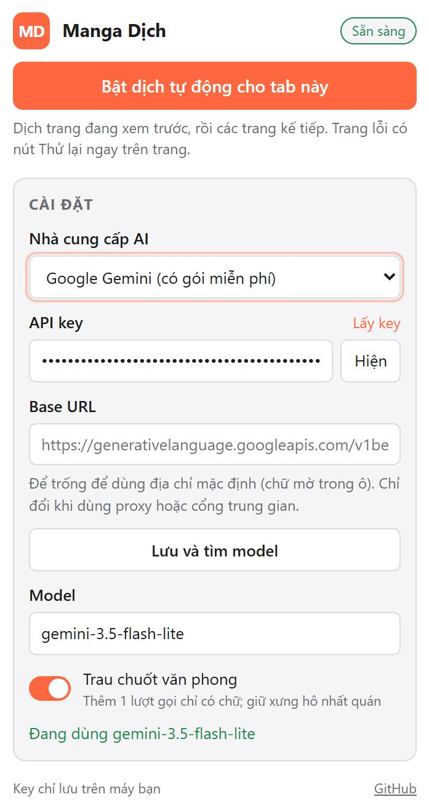
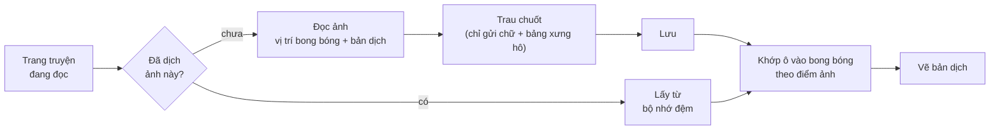

<div align="center">

# Manga Dịch

**Đọc manga, manhwa, manhua tiếng nước ngoài, hiện bản dịch tiếng Việt ngay trên bong bóng thoại.**

[](manga-dich/manifest.json) [](#cai-dat) [](#model) [](LICENSE)


[Tính năng](#tinh-nang) · [Cài đặt](#cai-dat) · [Sử dụng](#su-dung) · [Model](#model) · [Cách hoạt động](#cach-hoat-dong) · [Câu hỏi thường gặp](#faq) · [Phát triển](#phat-trien)

</div>

---

<a id="tinh-nang"></a>

## Tính năng



- **Dịch đúng chỗ.** Mỗi câu dịch nằm trên bong bóng của nó. Extension đọc điểm ảnh của trang để nới ô dịch phủ hết chữ gốc và lấy đúng màu nền của khung (khung tối thì chữ trắng). Bấm vào ô để xem lại chữ gốc.
- **Văn phong tự nhiên.** Phân biệt lời nói, lời nghĩ thầm, lời dẫn truyện. Giữ tên riêng và -san/-kun.
- **Xưng hô nhất quán.** Bảng xưng hô (ví dụ "Iori ↔ bạn gái: cậu/tớ") được ghi lại ngay từ trang đầu và áp dụng cho mọi trang sau trong tab.
- **Trau chuốt văn phong** *(tắt được)*. Lượt gọi thứ hai chỉ gửi chữ, viết lại cho trơn tru và đối chiếu chữ gốc để không sai nghĩa.
- **Tự dịch khi bạn đọc.** Trang đang xem được dịch trước, rồi tới 2 trang kế tiếp. Lật hay cuộn tới đâu dịch tới đó, ở cả chế độ đọc từng trang, cuộn dọc và cuộn ngang.
- **Nút Thử lại** ngay trên trang bị lỗi hoặc quá thời gian.
- **Không trả tiền hai lần.** Trang đã dịch được lưu theo nội dung ảnh, nên quay lại hay tải lại trang (F5) không tốn thêm token.
- **Tự chọn model.** Popup gọi thử thật từng model bằng một ảnh có 2 bong bóng ở vị trí biết trước, rồi chọn model nhanh nhất trong số đọc đúng chữ và đặt đúng ô.
- **Dùng miễn phí được** với gói free của Gemini, Groq, hoặc các model miễn phí trên OpenRouter (được xếp lên đầu danh sách).
- **Base URL tùy chỉnh** cho mọi nhà cung cấp (proxy, cổng trung gian), và nhà cung cấp **Tùy chỉnh** cho mọi server tương thích OpenAI: Ollama, LM Studio, vLLM… chạy ngay trên máy bạn.

<br clear="right">

<a id="cai-dat"></a>

## Cài đặt

> Extension chưa có trên Chrome Web Store, nên bạn cài bằng chế độ dành cho nhà phát triển.

1. **Tải mã nguồn:** bấm **Code → Download ZIP** rồi giải nén, hoặc chạy `git clone https://github.com/SakerLy/translate-managa.git`.
2. Mở trang quản lý extension:

   | Trình duyệt | Địa chỉ |
   |---|---|
   | Brave | `brave://extensions` |
   | Chrome | `chrome://extensions` |
   | Edge | `edge://extensions` |

3. Bật **Developer mode**.
4. Bấm **Load unpacked** và chọn thư mục **`manga-dich`** *(không phải thư mục gốc của repo)*.

<a id="su-dung"></a>

## Sử dụng

1. Bấm icon **Manga Dịch** trên thanh công cụ.
2. Trong khối **Cài đặt**: chọn **nhà cung cấp AI**, dán **API key** (link **Lấy key** dẫn tới trang tạo key), rồi bấm **Lưu và tìm model**.
   Popup gọi thử các model (mất khoảng 10 giây tới 2 phút), sau đó tự chọn model tốt nhất và chuyển nhãn sang **Sẵn sàng**. Bạn có thể chọn model khác trong ô **Model** hoặc tự gõ tên model; model đó cũng được gọi thử trước khi lưu.
3. Mở chương truyện, chờ ảnh tải xong, rồi bấm **Bật dịch tự động cho tab này** (nút chỉ bật khi đã cài đặt xong).
4. Đọc bình thường. Góc mỗi trang hiện `Đang dịch… 5s` trong lúc chờ. Trang nào lỗi sẽ có nút **Thử lại** ngay trên trang.

> [!TIP]
> Sau khi cập nhật extension (bấm ⟳ ở trang extensions), hãy **tải lại trang truyện (F5)** để trang dùng code mới.

<a id="model"></a>

## Chọn nhà cung cấp và model

| Nhà cung cấp | Lấy key | Chi phí |
|---|---|---|
| **Google Gemini** *(khuyên dùng)* | [aistudio.google.com](https://aistudio.google.com) | Có **gói miễn phí**. Dòng `flash-lite` nhanh nhất trong các lần thử. |
| **OpenRouter** | [openrouter.ai/keys](https://openrouter.ai/keys) | Một key dùng được hàng trăm model. Model miễn phí được xếp đầu danh sách, giới hạn 50 request/ngày (1.000/ngày nếu đã nạp tổng cộng từ 10 USD). |
| **Groq** | [console.groq.com/keys](https://console.groq.com/keys) | Có gói miễn phí. Model đọc ảnh theo tài liệu của Groq: `qwen/qwen3.8-27b`. *Chưa được test với key thật.* |
| **Anthropic** (Claude) | [console.anthropic.com](https://console.anthropic.com) | Trả phí |
| **OpenAI** (GPT) | [platform.openai.com](https://platform.openai.com) | Trả phí |
| **Tùy chỉnh** (tương thích OpenAI) | Tùy server | Server chạy trên máy (Ollama, LM Studio…) miễn phí và không cần key. Cần model đọc được ảnh và hỗ trợ JSON schema; bước gọi thử sẽ kiểm tra. |

### Base URL

Mỗi nhà cung cấp có ô **Base URL**. Để trống thì dùng địa chỉ mặc định (hiện mờ trong ô); chỉ điền khi đi qua proxy hoặc cổng trung gian. Với **Tùy chỉnh**, Base URL là bắt buộc:

| Server | Base URL |
|---|---|
| Ollama | `http://localhost:11434/v1` |
| LM Studio | `http://localhost:1234/v1` |
| Gemini (cổng tương thích OpenAI) | `https://generativelanguage.googleapis.com/v1beta/openai` |

Chỉ chấp nhận địa chỉ `http://` hoặc `https://`. API key được gửi tới đúng Base URL bạn nhập, nên chỉ dùng địa chỉ bạn tin tưởng. Cổng tương thích OpenAI của Gemini đã được test thật (lấy danh sách model, gọi thử đạt); Ollama và LM Studio chưa được test.

<details>
<summary><b>Kết quả đo thật của từng model</b></summary>

<br>

Đo ngày 17/11/2026 trên **một** trang MangaDex có 14 bong bóng. Mỗi lần chạy model trả về hơi khác nhau, nên các con số chỉ để tham khảo.

| Model | Miễn phí | Thời gian/trang | Bong bóng có ô dịch | Ô dịch đúng chỗ |
|---|---|---|---|---|
| `gemini-3.5-flash-lite` | Có | 3,5s | 100% | 100% |
| `gemini-3.1-flash-lite` | Có | 3–6s | 79–100% (trung bình 93%) | 92–100% |
| `particle-ai/particle-1:free` (OpenRouter) | Có | 25s | 100% | 100% |
| `openai/gpt-6-luna` (OpenRouter) | | 25s | 100% | 100% |
| `anthropic/claude-haiku-5.5` (OpenRouter) | | 22s | 93% | 100% |

Model mạnh hơn thì bước trau chuốt văn phong cũng làm tốt hơn, nhưng chậm hơn.

</details>

<details>
<summary><b>Một trang tốn bao nhiêu token?</b></summary>

<br>

Mỗi request chỉ gửi **ảnh trang truyện**, lời dặn (khoảng 290 token) và lời thoại trang trước. Extension không gửi HTML hay nội dung nào khác của trang web. Số đo với `gemini-3.1-flash-lite`:

| Chế độ | Request/trang | Token/trang (khoảng) |
|---|---|---|
| Tắt trau chuốt | 1 | 2.000 |
| Bật trau chuốt *(mặc định)* | 2 (3 ở trang có cặp nhân vật mới) | 4.000 |

Với hai model Gemini đã đo, token ảnh cố định ở 1.092 token/ảnh dù ảnh to hay nhỏ. Thu nhỏ ảnh đã được thử: không tiết kiệm token mà còn giảm độ chính xác. Vì vậy extension gửi ảnh ở kích thước gốc (cạnh dài tối đa 1.568px).

</details>

<a id="cach-hoat-dong"></a>

## Cách hoạt động



- **Đọc ảnh:** model trả về từng vùng chữ với vị trí `box_2d = [ymin, xmin, ymax, xmax]` trên thang 0–1000. Đây là định dạng Gemini được huấn luyện để xuất, theo tài liệu của Google, và chính xác hơn rõ so với tọa độ phần trăm tự đặt.
- **Trau chuốt** được tách thành bước riêng có chủ đích. Khi nhét quy tắc văn phong vào cùng request đọc ảnh, độ trúng bong bóng giảm từ 93% xuống 80% (đo 5 lần mỗi bản).
- **Bảng xưng hô** do bước trau chuốt cập nhật và được gửi kèm mọi trang sau. Trang nào tạo ra cặp nhân vật mới thì được trau chuốt lại một lần theo bảng đó. Trên dữ liệu thật, cách này đưa số câu lẫn xưng hô trong trang đó từ 1–2 câu về 0 (3/3 lần chạy).
- **Khớp ô** ([`fit.js`](manga-dich/fit.js)): tìm các mảng mực cỡ chữ quanh ô của model (viền bong bóng và nét vẽ là mảng lớn nên bị loại), nới ô cho phủ hết chúng, bỏ qua chữ của bong bóng bên cạnh, và lấy màu nền chiếm nhiều nhất trong ô. Đo trên 10 bộ kết quả thật: chữ gốc được che tăng trung bình khoảng 7 điểm phần trăm (từ 2 tới 11), phần lấn ra tranh tăng khoảng 1,5 điểm.
- **Bộ nhớ đệm** lưu tối đa 500 trang trong `chrome.storage.local`, theo mã băm SHA-256 của ảnh, model và chế độ trau chuốt.

## Quyền riêng tư

- API key chỉ lưu trên máy bạn (`chrome.storage.local`) và chỉ được gửi tới nhà cung cấp bạn chọn (hoặc Base URL bạn nhập).
- Ảnh trang truyện được gửi tới nhà cung cấp AI đó để dịch. Việc lưu dữ liệu tuân theo điều khoản của nhà cung cấp.
- Extension không có máy chủ riêng và không thu thập dữ liệu gì.

<a id="faq"></a>

## Câu hỏi thường gặp

<details>
<summary><b>Cứ hiện "Đang dịch…" rất lâu</b></summary>

Model đang chậm hoặc quá tải. Sau 150 giây không có phản hồi, trang báo lỗi và hiện nút **Thử lại**. Hãy chọn model nhanh hơn trong popup; thời gian gọi thử của từng model hiện ngay trong popup.
</details>

<details>
<summary><b>Ô dịch lệch, gộp hai bong bóng, hoặc còn lộ chữ gốc</b></summary>

Vị trí ô do model ước lượng, rồi được khớp lại theo điểm ảnh. Khi ô của model hụt quá nhiều, bước khớp chỉ nới tối đa gấp 2 lần để tránh che tranh, nên đôi khi vẫn lộ vài dòng chữ gốc. Model nhỏ cũng có lúc gộp 2 bong bóng sát nhau hoặc bỏ sót bong bóng nhỏ. Model lớn hơn thường chính xác hơn.
</details>

<details>
<summary><b>Xưng hô vẫn lẫn lộn</b></summary>

Hãy bật **Trau chuốt văn phong**: bảng xưng hô chỉ hoạt động khi bước này bật. Bảng được giữ cho cả tab, nên các trang đọc trước khi có bảng (hoặc lấy từ bộ nhớ đệm) có thể còn xưng hô cũ.
</details>

<details>
<summary><b>Gemini báo "high demand" hoặc "quota exceeded"</b></summary>

"High demand" là quá tải tạm thời, bấm **Thử lại** sau ít phút. "Quota exceeded … limit: 0" nghĩa là model đó không có trong gói miễn phí của bạn; popup tự bỏ qua và chọn model khác.
</details>

<details>
<summary><b>Có hỗ trợ xAI (Grok) hay Mistral không?</b></summary>

Chưa có mục riêng, vì tài liệu hiện tại của hai hãng chưa xác nhận đủ cách gửi ảnh và JSON theo schema. Bạn dùng được các model Grok, Mistral… qua **OpenRouter**, hoặc thử nhà cung cấp **Tùy chỉnh** với Base URL tương thích OpenAI của hãng (chưa được test; bước gọi thử sẽ cho biết có chạy hay không).
</details>

<details>
<summary><b>Có dịch được hiệu ứng âm thanh (SFX) không?</b></summary>

Chỉ dịch khi SFX ngắn và có nghĩa với cảnh. Ảnh hiển thị nhỏ hơn 200px (ảnh đại diện, ảnh bìa nhỏ) được bỏ qua.
</details>

<a id="phat-trien"></a>

## Phát triển

<details>
<summary><b>Cấu trúc mã nguồn</b></summary>

```
manga-dich/                 thư mục extension (Load unpacked thư mục này)
├── manifest.json           Manifest V3
├── background.js           Gọi API các nhà cung cấp (theo Base URL), trau chuốt, bảng xưng hô, bộ nhớ đệm, gọi thử model
├── content.js              Chọn trang cần dịch, mã hóa ảnh, vẽ lớp bản dịch, nút Thử lại
├── fit.js                  Khớp ô dịch vào bong bóng theo điểm ảnh, lấy màu nền
└── popup.html / popup.js   Cài đặt: nhà cung cấp, key, Base URL, model, trau chuốt (có chế độ tối)
test-background.js          Test unit (không gọi mạng)
test-fit.js                 Đo fit.js trên điểm ảnh thật: chữ gốc được che, phần lấn ra tranh
test-live.js                Test thật: dịch 1 trang, chấm vị trí ô dịch theo đáp án
test-probe.js               Test thật bước gọi thử model của popup
test-polish.js              Test thật bước trau chuốt văn phong
test-tokens.js              Đo token thật theo kích thước ảnh
draw-boxes.py               Vẽ ô của model (đỏ) và đáp án (xanh) lên ảnh
draw-probe.py               Tạo ảnh 2 bong bóng cho test-probe.js
test-fixtures/page4.truth.json   Vị trí 14 bong bóng của trang test (đo tay)
```

</details>

<details>
<summary><b>Chạy test</b></summary>

<br>

Cần [Node.js](https://nodejs.org) 18 trở lên. Các script `.py` cần Python và Pillow (`pip install pillow`).

```bash
node test-background.js
```

Test thật cần API key trong file `.env` ở thư mục gốc (đã nằm trong `.gitignore`):

```
GEMINI_API_KEY=...
OPENROUTER_API_KEY=...
GROQ_API_KEY=...
```

Ảnh trang truyện dùng để test **không có trong repo** vì thuộc bản quyền của tác giả và nhóm dịch. Hãy tự lưu một trang thành `test-fixtures/page4.png`. File đáp án `page4.truth.json` khớp với trang 4, chương 12 của *Bijin de Okane Mochi no Kanojo ga Hoshii to Ittara…* trên MangaDex (ảnh 768×1087). Nếu dùng trang khác, hãy tự đo lại đáp án rồi kiểm tra bằng `draw-boxes.py`.

```bash
node test-live.js test-fixtures/page4.png
```

```bash
python draw-probe.py test-fixtures/probe.png
```

```bash
node test-probe.js gemini gemini-3.1-flash-lite
```

`test-live.js` lưu kết quả vào `test-fixtures/result-*.json`, và `test-fit.js` đo `fit.js` trên các kết quả đó (cần ảnh ở dạng RGBA thô, cách tạo ghi ở đầu file):

```bash
node test-fit.js page4.rgba test-fixtures/result-*.json
```

Một trang **ĐẠT** khi ít nhất 80% bong bóng có ô dịch đặt lên và ít nhất 80% ô dịch nằm đúng một bong bóng. Có thể đặt `ONLY=gemini` để chỉ test một nhà cung cấp, `MODEL_GEMINI=tên-model` để test một model cụ thể.

</details>

## Giấy phép

Copyright © 2026 SakerLy

Phát hành theo **[GNU General Public License v3.0](LICENSE)**. Bạn được dùng, sửa và phân phối lại, với điều kiện bản sửa đổi khi phát hành cũng phải mở mã nguồn theo GPL-3.0. Phần mềm được cung cấp **không kèm bất kỳ bảo đảm nào**.

<sub>Manga Dịch chỉ là công cụ hỗ trợ đọc. Bản quyền nội dung truyện thuộc về tác giả, nhà xuất bản và nhóm dịch. Hãy ủng hộ bản chính thức khi có thể.</sub>
