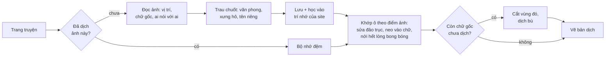

<div align="center">

# Manga Dịch

**Đọc manga bằng tiếng Việt: bản dịch hiện ngay trên bong bóng thoại, từ bản gốc tiếng Nhật hay bản scan tiếng Anh, Tây Ban Nha, Indonesia…**

[](manga-dich/manifest.json) [](#cai-dat) [](#model) [](LICENSE)


[Tính năng](#tinh-nang) · [Cài đặt](#cai-dat) · [Sử dụng](#su-dung) · [Model](#model) · [Cách hoạt động](#cach-hoat-dong) · [Hỏi đáp](#faq) · [Phát triển](#phat-trien)

</div>

---

<a id="tinh-nang"></a>

## Tính năng

### Dịch đúng, đọc như truyện Việt
- **Chỉ dành cho manga:** bản gốc tiếng Nhật, hoặc bản scan mà nhóm dịch nước ngoài đã chuyển sang tiếng Anh, Tây Ban Nha, Indonesia, Pháp… Bản scan vẫn được dịch theo văn phong manga, và kính ngữ bị nhóm dịch đổi (Miss Tanaka, señor) được trả lại thành Tanaka-san.
- **Văn phong manga:**
  - Giữ -san/-kun/-chan/-sama, senpai, sensei. Tên Nhật giữ romaji (Tanaka Yuki).
  - Cách tự xưng gợi giọng nhân vật: 俺 → tao/tôi, 僕 → tớ/em, わし → lão, 拙者 → tại hạ.
  - Theo thể loại: học đường/romcom (cậu/tớ, nhẹ nhàng), shounen (gọn, có lực), isekai/fantasy (mạo hiểm giả, ma vương, kỹ năng), seinen/kinh dị (câu chắc, giữ không khí), samurai/cổ trang (ta/ngươi, bệ hạ/thần).

- **Xưng hô đúng quan hệ:** lượt đọc ảnh ghi lại *ai nói với ai* ("em gái → anh trai"), rồi lượt trau chuốt áp bảng quy tắc xưng hô Việt:
  - gia đình: anh/em, chị/em, bố mẹ/con, ông bà/cháu
  - họ hàng: bác, chú, cô, cậu, dì
  - trường lớp: cậu/tớ, senpai, thầy cô
  - người lớn với học sinh: cô/chú - cháu (không bao giờ cậu/tớ)
  - công sở, người lạ, kẻ thù, samurai/fantasy

  Ví dụ đo thật: お兄ちゃん、遅いよ！ → "Anh hai, chậm quá đi!"; ông nói với hai cháu → "Ồ, cả hai đứa đến rồi à."; nữ sinh với mẹ bạn (bản scan Tây Ban Nha) → "Cháu cảm ơn cô đã đưa Momiji về ạ."
- **AI nhớ qua từng chapter:** bảng xưng hô (kèm quan hệ) và tên riêng được lưu theo từng site. Đổi chapter hay tắt trình duyệt vẫn đúng như trước. **Sửa tay được** trong trang cài đặt nếu AI ghi sai.
- **Không dịch word-by-word:** câu chào, cảm thán, câu đùa, thành ngữ được viết lại theo cách nói tự nhiên của tiếng Việt.

### Ô dịch khớp bong bóng, không sót chữ
- **Bám theo điểm ảnh:**
  - Ô dịch bắt đầu từ chính các nét chữ gốc, rồi nới ra hết lòng bong bóng, nên chữ Việt to dễ đọc và không tràn ra tranh.
  - Lấy đúng màu nền của khung (khung tối thì chữ trắng).
- **Tự sửa tọa độ sai của model:**
  - Model trả tọa độ đảo trục (x↔y, hay gặp với GPT/Claude qua cổng trung gian) → tự phát hiện và lật lại.
  - Bộ sửa đảo trục vẫn hoạt động ở cảnh tối nhiều lá, mưa, nét gạch: những nét có cỡ lộn xộn không bị tính là chữ.
  - Ô chỉ phủ một phần khối chữ gốc → nới ra phủ trọn khối.
  - Ô nằm trên tranh, không có chữ → dời về khối chữ thật gần nhất.
  - Ô khổng lồ phủ nửa trang → bỏ.
- **Cỡ chữ theo chữ gốc:**
  - Chữ dịch lấy chiều cao chữ gốc của bong bóng làm chuẩn, giống cách người làm chữ truyện làm.
  - Câu ngắn trong bong bóng rộng không bị phóng khổng lồ.
  - Câu dài trong bong bóng hẹp thì ô tự nới ra thay vì thu chữ li ti.
- **Dịch bù chữ bị sót:** tự dò các khối chữ còn nguyên chữ gốc mà chưa có bản dịch, cắt riêng vùng đó ở độ phân giải gốc rồi gửi AI dịch lại (tối đa 4 vùng/trang).
- Ô trùng nhau được gộp, ô chồng nhau được tách. Bấm vào ô để xem lại chữ gốc.

### Dễ dùng
- **Tự dịch theo site:** bật một lần cho MangaDex (hay site bất kỳ), sau đó mở chapter nào là tự dịch, không cần bấm icon nữa.
- **Phím tắt** <kbd>Alt</kbd>+<kbd>Shift</kbd>+<kbd>D</kbd> để dịch tab đang mở.
- **Huỷ bất cứ lúc nào:**
  - mỗi trang đang dịch có nút **Huỷ** ngay trên trang
  - popup có nút **Dừng dịch tab này** để dừng cả tab

  Trang chưa gửi đi sẽ không tốn lượt gọi API.
- **Trang cài đặt riêng, tự lưu khi gõ:** không còn cảnh bấm ra ngoài popup là mất key đang nhập dở.
- **Tự chọn model:** gọi thử từng model bằng một ảnh mẫu, chọn model nhanh nhất trong số đọc đúng chữ và đặt đúng ô.
- **Dịch trước trang kế tiếp:** trang đang xem được dịch trước, rồi tới 2 trang sau. Chạy được với kiểu đọc từng trang, cuộn dọc và cuộn ngang.
- **Không trả tiền hai lần:** trang đã dịch được lưu theo nội dung ảnh, quay lại hay F5 không tốn token. Trang không có chữ (bìa, minh họa) được bỏ qua.
- **Chịu lỗi cổng trung gian:** gặp "reset after 1m 50s" thì chờ đúng thời gian rồi tự gọi lại; lỗi hiện rõ nguyên nhân thật thay vì "Provider returned error".

<a id="cai-dat"></a>

## Cài đặt

> Extension chưa có trên Chrome Web Store, nên bạn cài bằng chế độ dành cho nhà phát triển.

1. **Tải mã nguồn:** bấm **Code → Download ZIP** rồi giải nén, hoặc `git clone https://github.com/SakerLy/translate-managa.git`.
2. Mở trang quản lý extension: `brave://extensions` · `chrome://extensions` · `edge://extensions`.
3. Bật **Developer mode**.
4. Bấm **Load unpacked** và chọn thư mục **`manga-dich`** *(không phải thư mục gốc của repo)*.

> [!TIP]
> Sau khi cập nhật code, bấm ⟳ ở trang extensions rồi **tải lại trang truyện (F5)**. Nếu quên, popup sẽ nhắc và có sẵn nút tải lại.

<a id="su-dung"></a>

## Sử dụng

1. **Kết nối AI (một lần):** bấm icon **Manga Dịch** → **Mở cài đặt** (hoặc nút ⚙). Trang cài đặt mở trong tab mới:
   - chọn nhà cung cấp, dán **API key** (và **Base URL** nếu dùng cổng trung gian)
   - bấm **Tìm model tốt nhất**

   Mọi ô được lưu ngay khi gõ.
2. **Đọc truyện:** mở chapter rồi bấm **Dịch trang này**, hoặc nhấn <kbd>Alt</kbd>+<kbd>Shift</kbd>+<kbd>D</kbd>.
3. **Khỏi bấm lần sau:** bật **Tự dịch trên ‹site›** trong popup.

Trong lúc chờ, góc trang hiện `Đang dịch… 5s` cùng nút **Huỷ**. Bản nháp hiện trước, bản trau chuốt thay vào sau. Trang lỗi có nút **Thử lại**, trang đã huỷ có nút **Dịch lại**.

Muốn dừng cả tab: mở popup → **Dừng dịch tab này**. Các trang đã dịch vẫn giữ nguyên. Bấm **Dịch trang này** hoặc phím tắt để chạy tiếp.

Trang đang gọi API dở thì vẫn chạy nốt ở nền. Kết quả được lưu vào bộ nhớ đệm, nên **Dịch lại** sau đó không tốn thêm token.

| Công tắc | Tác dụng |
|---|---|
| Trau chuốt văn phong & xưng hô | Thêm 1 lượt gọi chỉ có chữ: câu tự nhiên, xưng hô đúng quan hệ và nhất quán. **Nên bật.** |
| Dịch bù chữ bị sót | Dò và dịch lại bong bóng model bỏ sót. |
| Dịch cả SFX | Tắt để chỉ giữ lời thoại; đổi ngay trên trang, không gọi lại. |
| Bỏ qua trang không có chữ | Không tốn lượt gọi cho trang bìa/minh họa; có nút "Vẫn dịch". |

<a id="model"></a>

## Chọn nhà cung cấp và model

| Nhà cung cấp | Lấy key | Chi phí |
|---|---|---|
| **Google Gemini** *(khuyên dùng)* | [aistudio.google.com](https://aistudio.google.com/apikey) | Có **gói miễn phí**; dòng `flash-lite` nhanh nhất. |
| **OpenRouter** | [openrouter.ai/keys](https://openrouter.ai/keys) | Một key dùng hàng trăm model; model miễn phí xếp đầu danh sách. |
| **Groq** | [console.groq.com/keys](https://console.groq.com/keys) | Có gói miễn phí. *Chưa test với key thật.* |
| **Anthropic** (Claude) | [console.anthropic.com](https://console.anthropic.com/settings/keys) | Trả phí |
| **OpenAI** (GPT) | [platform.openai.com](https://platform.openai.com/api-keys) | Trả phí |
| **Tùy chỉnh** | Cổng trung gian, Ollama, LM Studio… | Theo server. |

**Cổng trung gian bán API nhiều hãng** (vd `https://ten-cong.example/v1`): chọn **Tùy chỉnh**, dán Base URL có `/v1` ở cuối và key của cổng. Cổng này nói theo chuẩn OpenAI cho mọi model, kể cả Claude và Gemini. Danh sách model được đọc nguyên văn, và bước gọi thử sẽ quyết định model nào dùng được.

| Server chạy trên máy | Base URL |
|---|---|
| Ollama | `http://localhost:11434/v1` |
| LM Studio | `http://localhost:1234/v1` |

<details>
<summary><b>Kết quả đo thật</b></summary>

<br>

Trang test MangaDex có 14 bong bóng, đáp án vị trí đo tay. Mỗi lần chạy model trả về hơi khác nhau, nên con số chỉ để tham khảo.

| Model | Bong bóng trúng: ô của model → sau khi khớp theo điểm ảnh | Ô lấn ra tranh |
|---|---|---|
| `gemini-flash-lite-latest` | 12/14 → **14/14** | 4% |
| `openai/gpt-6-luna` (OpenRouter) | 14/14 → **14/14** | 5% |
| `meta/muse-ember` (OpenRouter) | 12/14 → **14/14** | 11% → 5% |
| `anthropic/claude-haiku-5.5` (OpenRouter) | 13/14 → **14/14** | 6% → 1% |
| `openrouter/free` (trả tọa độ đảo trục) | 8/14 → **12/14** | 34% → 6% |

Extension luôn yêu cầu ảnh `detail: high`, và bước dịch bù sẽ bắt các bong bóng model bỏ sót.

</details>

<details>
<summary><b>Một trang tốn bao nhiêu token?</b></summary>

<br>

Mỗi request chỉ gửi **ảnh trang truyện**, lời dặn và lời thoại trang trước. Không gửi HTML hay nội dung nào khác của trang web.

| Chế độ | Request/trang | Token/trang (khoảng, Gemini flash-lite) |
|---|---|---|
| Tắt trau chuốt | 1 | 2.000 |
| Bật trau chuốt *(mặc định)* | 2 (3 ở trang có cặp nhân vật mới) | 4.000 |
| Dịch bù | +1 cho mỗi vùng sót (ảnh cắt nhỏ, không trau chuốt) | +~600 mỗi vùng |

</details>

<a id="cach-hoat-dong"></a>

## Cách hoạt động



- **Đọc ảnh:** model trả từng khối chữ với `box_2d = [ymin, xmin, ymax, xmax]` (thang 0–1000), bản dịch, chữ gốc và người nói → người nghe.
- **Trau chuốt** là bước riêng, chỉ gửi chữ. Gộp quy tắc văn phong vào cùng request đọc ảnh làm độ trúng bong bóng giảm từ 93% xuống 80% (đo 5 lần mỗi bản).
- **Khớp ô** ([`fit.js`](manga-dich/fit.js)) gồm các bước:
  1. Tìm các mảng mực cỡ chữ quanh ô của model.
  2. Lấy chúng làm lõi, rồi nới từng cạnh ra khi hàng/cột kế bên vẫn là nền bong bóng.
  3. Ô không có chữ bên dưới thì đổi trục hoặc dời sang khối chữ gần nhất mà [`textBlocks`](manga-dich/fit.js) tìm được.
- **Bộ nhớ đệm:** tối đa 500 trang trong `chrome.storage.local`, khóa theo SHA-256 của ảnh, model và chế độ dịch.

## Quyền riêng tư

- API key chỉ lưu trên máy bạn (`chrome.storage.local`) và chỉ được gửi tới nhà cung cấp hoặc Base URL bạn chọn.
- Ảnh trang truyện được gửi tới nhà cung cấp AI đó để dịch; việc lưu dữ liệu theo điều khoản của họ.
- Extension không có máy chủ riêng và không thu thập dữ liệu gì. Quyền `tabs` chỉ dùng để biết tab vừa tải có thuộc site bạn bật **Tự dịch** hay không.

<a id="faq"></a>

## Hỏi đáp

<details>
<summary><b>Ô dịch lệch hoặc còn lộ chữ gốc</b></summary>

Ô được khớp lại theo điểm ảnh và có bước dịch bù, nhưng bong bóng không viền liền với vùng tranh trắng có thể làm ô nới chưa chuẩn. Model mạnh hơn (hoặc gọi thẳng nhà cung cấp thay vì qua cổng trung gian) cho vị trí tốt hơn hẳn. Bấm vào ô để xem chữ gốc bên dưới.
</details>

<details>
<summary><b>Xưng hô vẫn sai (vd anh/em bị đảo)</b></summary>

Bật **Trau chuốt văn phong & xưng hô**. Nếu AI đã ghi sai quan hệ vào trí nhớ, mở **Cài đặt → Trí nhớ AI** và sửa dòng đó, ví dụ `Ken ↔ Mio (anh trai ↔ em gái): Ken xưng anh gọi Mio là em; Mio xưng em gọi Ken là anh hai`. Trang sau sẽ theo ngay. Trang đã dịch nằm trong bộ nhớ đệm giữ bản cũ.
</details>

<details>
<summary><b>Cổng trung gian báo "quota" / "reset after…" / 503</b></summary>

Cổng đang hết lượt cho model đó. Extension tự chờ và gọi lại (tối đa 2 lần, mỗi lần ≤ 5 phút). Nếu vẫn lỗi, thử model khác trong trang cài đặt (nút **Thử** từng model) hoặc đợi cổng hồi quota.
</details>

<details>
<summary><b>Cứ hiện "Đang dịch…" rất lâu</b></summary>

Model chậm hoặc quá tải. Sau 150 giây trang báo lỗi kèm nút **Thử lại**. Chọn model nhanh hơn: trang cài đặt hiện thời gian gọi thử của từng model.
</details>

<details>
<summary><b>"Provider returned error" hoặc lỗi JSON schema</b></summary>

Từ bản 0.5 lỗi hiện nguyên nhân thật của nhà cung cấp. Lỗi schema kiểu *"required … Missing 'x'"* là do model không hỗ trợ JSON schema strict; chọn model khác.
</details>

<a id="phat-trien"></a>

## Phát triển

<details>
<summary><b>Cấu trúc mã nguồn</b></summary>

```
manga-dich/                   thư mục extension (Load unpacked thư mục này)
├── manifest.json             Manifest V3: popup, trang cài đặt, phím tắt
├── background.js             Gọi API (theo Base URL), prompt đọc ảnh + trau chuốt (xưng hô, thể loại),
│                             hàng đợi, bộ nhớ đệm, trí nhớ theo site, tự dịch theo site, phím tắt
├── content.js                Chọn trang cần dịch, vẽ lớp bản dịch, dịch bù vùng sót, nút Thử lại
├── fit.js                    Khớp ô theo điểm ảnh: sửa đảo trục, neo vào chữ, nới lòng bong bóng; textBlocks()
├── text.js                   Ngắt dòng theo dáng bong bóng; dò trang không có chữ
├── popup.html / popup.js     Popup gọn: Dịch trang này, tự dịch theo site, công tắc nhanh
├── options.html / options.js Trang cài đặt (mở trong tab, tự lưu): kết nối AI, model, cách dịch, trí nhớ AI
└── ui.css                    Giao diện chung (sáng/tối theo trình duyệt)
test-background.js            Test unit API/nhà cung cấp (không gọi mạng)
test-v04.js                   Test unit: gộp ô, style, quota, trí nhớ theo site, separate()
test-v05.js                   Test unit: sửa đảo trục, neo ô, textBlocks, schema strict, prompt xưng hô/thể loại, UI
test-text.js                  Test ngắt dòng + dò trang không chữ
test-fit.js                   Đo fit.js trên điểm ảnh thật
test-live.js / test-ab.js     Test thật: dịch 1 trang, chấm vị trí ô theo đáp án; so sánh prompt A/B
test-probe.js / test-polish.js / test-tokens.js   Test thật bước gọi thử, trau chuốt, đo token
draw-boxes.py                 Vẽ ô của model (đỏ) và đáp án (xanh) lên ảnh
```

</details>

<details>
<summary><b>Chạy test</b></summary>

<br>

Cần [Node.js](https://nodejs.org) 18+. Các script `.py` cần Python và Pillow (`pip install pillow`).

```bash
node test-background.js && node test-v04.js && node test-v05.js && node test-text.js
```

Test thật cần key trong file `.env` ở thư mục gốc (đã nằm trong `.gitignore`):

```
GEMINI_API_KEY=...
OPENROUTER_API_KEY=...
CUSTOM_API_KEY=...                      # cổng trung gian (nhà cung cấp Tùy chỉnh)
CUSTOM_BASE_URL=https://ten-cong.example/v1
```

Ảnh trang truyện dùng để test **không có trong repo** (bản quyền của tác giả và nhóm dịch). Tự lưu trang thành `test-fixtures/page4.png` / `page5.png`. Các file `*.truth.json` khớp trang 4–5, chương 12 của *Bijin de Okane Mochi no Kanojo ga Hoshii to Ittara…* trên MangaDex (768×1087).

```bash
node test-live.js test-fixtures/page4.png               # mọi nhà cung cấp có key
ONLY=custom MODEL_CUSTOM=gpt-6.1-terra node test-live.js test-fixtures/page5.png
python -c "from PIL import Image; open('page4.rgba','wb').write(Image.open('test-fixtures/page4.png').convert('RGBA').tobytes())"
node test-fit.js page4.rgba test-fixtures/result-*.json
```

Một trang **ĐẠT** khi ít nhất 80% bong bóng có ô dịch đặt lên và ít nhất 80% ô dịch nằm đúng một bong bóng.

</details>

## Giấy phép

Copyright © 2026 SakerLy

Phát hành theo **[GNU General Public License v3.0](LICENSE)**. Bạn được dùng, sửa và phân phối lại, với điều kiện bản sửa đổi khi phát hành cũng phải mở mã nguồn theo GPL-3.0. Phần mềm được cung cấp **không kèm bất kỳ bảo đảm nào**.

<sub>Manga Dịch chỉ là công cụ hỗ trợ đọc. Bản quyền nội dung truyện thuộc về tác giả, nhà xuất bản và nhóm dịch. Hãy ủng hộ bản chính thức khi có thể.</sub>
